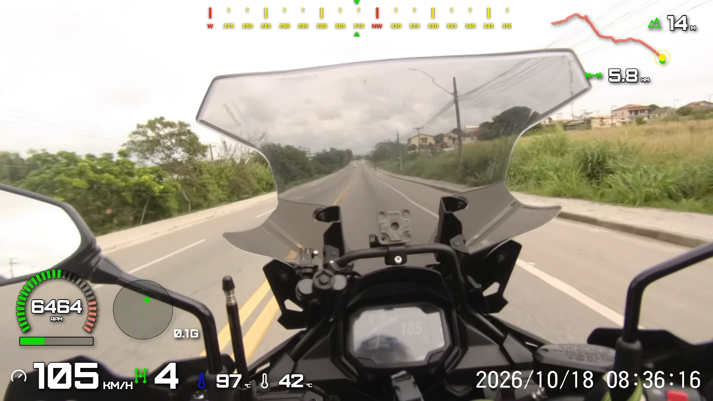

  

# OVRLEY, fork by ledzpg

An overlay made with this fork: RPM arc gauge with color bands, speed, gear, coolant and intake air temperatures, G-force, compass and route/elevation.

This is a fork of [OVRLEY](https://github.com/spirokai/OVRLEY) by [spirokai](https://github.com/spirokai)
([www.ovrley.cc](https://www.ovrley.cc)). It was built for motorcycle data logging, with a focus on tachometer
clusters, engine temperatures and map views. Everything OVRLEY does, this fork still does; the list below is only what
was **added or changed**. It is not affiliated with, or endorsed by, the original project.

> **Thank you, [spirokai](https://github.com/spirokai).** OVRLEY is an excellent program, and everything in this fork
> stands on the solid, well-built foundation you created and released as free software. If you find this fork useful,
> please also have a look at the [original project](https://github.com/spirokai/OVRLEY) and
> [www.ovrley.cc](https://www.ovrley.cc).

- Downloads: [Releases](https://github.com/Ledzpg/OVRLEY/releases) (Windows x64 installer, `OVRLEY-fork_by_ledzpg_<version>_x64-setup.exe`)
- The original project's README, with its full feature list and documentation, is kept in
  [`docs/UPSTREAM_README.md`](docs/UPSTREAM_README.md)
- Fork base: upstream `main` at commit `13c3f41f`
- Work branch: [`ledzpg`](https://github.com/Ledzpg/OVRLEY/tree/ledzpg)
- License: GPL-3.0-or-later, unchanged (see [`LICENSE.md`](LICENSE.md))

## At a glance

| Area | Addition |
| --- | --- |
| Metrics | Coolant and intake air temperature, fuel level, battery voltage and estimated range, imported from CSV |
| Gauges | Fixed scale with a redline, tick marks and numerals, color bands with gradients, blinking redline overrun, needle |
| Widgets | Per-widget shadow, close-up map that follows the current position, widget sets ("Cluster", "Temps.") |
| Maps | Raster map tiles behind the route widget (OpenStreetMap, OpenTopoMap, Esri Light Gray or a custom URL) |
| Templates | Tachometer cluster, vertical bars cluster, temperatures panel, Bebas Neue bundled |
| Release | Own signing key, own update channel and app identity, so it installs next to upstream OVRLEY |

## Metrics

- **Coolant temperature** and **intake air temperature** are new metrics (°C, with a °F display option), shown with
  the thermometer icon like the existing temperature widget.
- The CSV importer recognizes exact header aliases such as `Coolant Temperature (°C)`, `ECT`, `Intake Air Temp` or
  `IAT`. Fahrenheit columns are converted on import, and readings outside -60 to 300 °C are dropped as a
  disconnected sensor.
- **Fuel level** (litres, or a percentage of the tank), **battery voltage** (V) and **estimated range** (km or miles)
  are also new metrics, in the Motorsports category, each with its own icon. As text, arc, corner or linear widgets.
  The CSV columns are `Fuel Level (L)`, `Battery Voltage (V)` and `Estimated Range (km)` (or `mi`). A fuel level in
  percent cannot be imported, because converting it needs the tank capacity.
- A fuel level widget has a **Tank Capacity** field (litres) in its settings, used to show the level as a percentage.
  It is not read from the file, so it works for any vehicle.
- A battery reading of 0 V is dropped as a sensor that is not answering; implausible fuel and range values are
  dropped too.
- Only the CSV importer fills these metrics; the FIT and GPX parsers do not.

## Gauges

These apply to the arc, corner and linear gauges unless noted.

- **Fixed scale and redline** for RPM and the two temperature metrics: choose a minimum and maximum instead of
  auto-ranging, and mark where the redline starts.
- **Tick marks and numerals** (arc and corner gauges): major ticks with numerals, minor ticks in between, inside or
  outside the track, with a label divisor (for example RPM ÷ 1000 gives 0 to 11). Everything past the redline takes
  the redline color.
- **Color bands with gradients**: split the fill into zones, each with a solid color or a gradient between two colors.
  A gradient can follow the next band (the default, so it keeps blending into that band when you recolor it) or end in
  a color of its own. The last band ends exactly at the redline.
- **Blinking redline overrun**: when the value passes the redline the whole bar can fill with the redline color and
  blink.
- **Needle** (arc and corner gauges): length, width, offset from the track, corner radius, border, and a fill that can
  be a solid color or a gradient, with color **and opacity** for each end.
- The vertical offset of an arc gauge label can now go up to ±150 px (it was ±50).

## Widgets

- **Per-widget shadow**: strength and distance can be set on each label, value and plot widget. When unset, a widget
  follows the global shadow settings, as before.
- **Close-up map ("Map+")**: a new plot widget that follows the current position at a zoom level you choose, with the
  full route drawn on it (done and remaining parts in separate styles) and an arrow marker. It can keep north up or
  rotate with the direction of travel. Zoom, map detail, line styles and marker are all configurable.
- **Widget sets** in the widget drawer: one click adds a tachometer cluster (RPM dial, speed and gear) or a
  coolant + intake air temperatures panel, already laid out. The sets are read from the template files in
  `templates/`, so editing those files changes what the buttons add.

## Maps

- **Raster map tiles behind the route widget**, with the map aligned to the route. Presets: OpenStreetMap,
  OpenTopoMap and Esri Light Gray. For providers that need an API key you can paste your own tile URL.
- Opacity, level of detail and the attribution text are configurable. Tiles are cached on disk for 14 days, and an
  expired tile is still used if the server cannot be reached.
- If a tile cannot be loaded the render stops with a message that names the URL, instead of producing a partial map.
- Tile servers are identified with a `OVRLEY-luizleite/<version>` User-Agent that points to this fork, so any tile
  provider contact goes to this project and not to upstream.

Please respect the usage policy of each tile provider. The public OpenStreetMap servers are not meant for heavy
bulk use.

## Templates

New templates in [`templates/`](templates):

- `cluster-tacometro-velocimetro`: RPM dial with a redline, large speed, a gear box and a small RPM readout.
- `cluster-barras-verticais`: speed and gear plus two vertical bars (RPM and coolant temperature).
- `painel-temperaturas`: two dials for coolant and intake air temperature.
- `mapa-trajeto`: route widget with the raster map behind it.

Fixes to the bundled templates: Bebas Neue is now shipped with the app (with its OFL license), and templates no longer
refer to fonts that exist only on some PCs, which used to fail with "font family is unavailable".

## Release and identity

This fork can be installed and updated on its own, without touching an upstream OVRLEY install.

- Own app identifier (`io.github.ledzpg.ovrley`) and product name, so install folder, settings and cache are
  separate from upstream.
- Own updater signing key and update channel: the app checks the releases of this repository, not upstream's.
- Windows x64 installer only. The macOS and Linux build workflows from upstream are not used by this fork and those
  platforms are not tested here.
- Your own templates and projects stay in `Documents\OVRLEY`, as in upstream, so they are found by either install.

## Languages

All texts added by this fork are available in the same 15 languages as the original interface. English and Portuguese
(pt-BR) were written by the fork's author; the other 13 (cs, de, es, fr, it, ja, ko, nl, pl, ru, sv, tr, zh-CN) were
translated with AI assistance and have not been reviewed by native speakers. Corrections are welcome as issues or pull
requests.

## Verification

Each change above has automated tests (Rust integration tests for the renderer, Vitest for the editor), and the
gauges, the route map and the close-up map were also checked visually against real logs. The installed app and a full
video render were not exercised end to end for every change. If something looks wrong, please open an issue.

## Staying close to upstream

The original repository is kept as the `upstream` remote and this fork is meant to track it: fixes and features from
upstream can be merged here. Changes in this fork are documented per feature in the commit history of the
[`ledzpg`](https://github.com/Ledzpg/OVRLEY/tree/ledzpg) branch.
